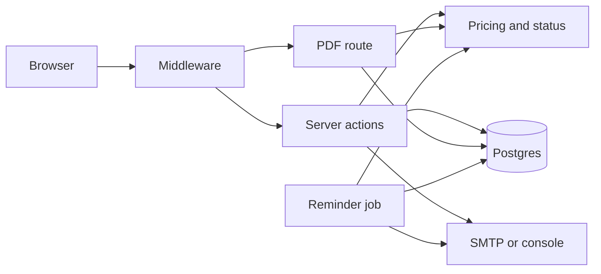

# InvoiceLane

InvoiceLane is a small invoicing desk. You keep clients, write invoices with line items and tax, download a PDF, and send it by email. A reminder job moves past-due invoices to overdue and emails the client again until a cap is reached.

## Features

- Accounts with a signed session cookie. Dashboard pages and the PDF route reject anonymous requests.
- Clients, with a name, email, company, address, and phone.
- Invoices and line items. Drafts can be edited or deleted. Sending locks the lines.
- Statuses are draft, sent, paid, and overdue.
- Totals and tax are calculated in one TypeScript module and covered by tests.
- A PDF for every invoice, from a route handler.
- A reminder sweep you can run as a script or call over HTTP. It emails the invoice PDF.
- Local mail goes to the terminal, or to Mailpit when you turn on SMTP.

## Architecture



The browser never talks to Postgres. Server actions and the PDF route do. Middleware only checks the cookie. The reminder job uses the same status rules as the "Send" button, then asks the mailer to deliver.

## Folder structure

```
src/app                  pages, the PDF route, and the cron route
src/actions              server actions for auth, clients, and invoices
src/components           forms and the invoice table
src/db                   Drizzle schema, connection, and seed
src/jobs                 reminder sweep and the CLI entry
src/lib                  pricing, status, sessions, PDF, mail
src/middleware.ts        cookie check for /dashboard and /api/invoices
src/server               queries and the email/PDF assembly
drizzle                  SQL migration and the Drizzle snapshot
```

## Run locally

You need Node 22 and Docker.

```bash
cp .env.example .env
docker compose up -d
npm install
npm run db:migrate
npm run db:seed
npm run dev
```

Open http://localhost:3000.

The seed creates `demo@invoicelane.dev`. The password is `SEED_PASSWORD` in `.env` (the example uses `invoicelane-demo`). The seed also inserts a draft, a sent invoice that is not due yet, a sent invoice that is already past due, an overdue invoice, and a paid one. Running it twice does nothing if that user already exists.

`EMAIL_MODE=console` prints messages in the process that sends them. To see them in a mailbox instead, set:

```
EMAIL_MODE=smtp
SMTP_HOST=localhost
SMTP_PORT=1025
```

Mailpit's UI is http://localhost:8025. It does not need SMTP credentials.

Reminders:

```bash
npm run reminders
```

That marks sent invoices overdue once the due date is in the past, then emails a reminder when the cooldown has elapsed and the invoice is under the cap. `REMINDER_COOLDOWN_DAYS` defaults to 3 and `REMINDER_MAX_COUNT` defaults to 4. Dates are evaluated in `APP_TIMEZONE` (UTC unless you change it). The due date itself is still open; overdue starts the next day.

The same sweep is exposed as `GET` or `POST /api/cron/reminders` with `Authorization: Bearer $CRON_SECRET`. `vercel.json` points a daily 14:00 UTC cron at that path for a host that reads it. One scheduler is enough. The job claims a row before it sends, and puts the reminder count back if SMTP throws, so two overlapping runs do not both email.

## Tests

```bash
npm test
npm run lint
npm run build
```

`npm test` covers pricing, status transitions, the reminder plan, session cookies, passwords, form parsing, and PDF pagination. It does not need Postgres. `npm run build` typechecks the app and compiles it. `npm run typecheck` runs `tsc` on its own; Next writes route types into `.next` during dev or build, so run one of those first.

## Design decisions

Money is integer cents. Quantities are hundredths (`150` is 1.50). Tax is basis points (`825` is 8.25%) and is stored on the invoice, so a later edit to a different draft does not change an invoice you already sent. Each line is rounded half up to the nearest cent, then tax is rounded half up on the subtotal. The caps on quantity and price keep that math inside safe integers. The database checks the same bounds it can express: tax between 0 and 100 percent, a due date that is not before the issue date, and a positive quantity.

Status is stored, not only derived. Draft, sent, and paid are things a person did. Overdue is applied by the sweep when a sent invoice's due date is before today. Paid and draft invoices are left alone. Sending a draft that is already past due stores it as overdue and still sends the invoice email. That send counts as contact, so the first reminder waits for the cooldown.

Only drafts can be edited. Saving a draft replaces its line items in one transaction. Invoice numbers start at 1001 and increment per account. A unique index on `(user_id, number)` is what makes a concurrent create safe; the insert retries when it loses that race.

The session cookie is HMAC-signed and holds the user id and an expiry. `src/middleware.ts` verifies it without a database round trip. Next.js 16 prints a notice that this file is now called `proxy.ts`. The gate is the same request check; `proxy.ts` is pinned to the Node.js runtime, and this one does not need Node, so the file stays middleware. Server actions still load the user before they read or write rows, so a deleted account stops working even if the cookie has not expired. There is no revocation list: signing out clears the cookie, and a stolen cookie works until it expires (14 days). That is the tradeoff for keeping the gate off Postgres.

The PDF is drawn with pdf-lib in a route handler so the file the browser downloads is the same file the email attaches. Standard PDF fonts only cover WinAnsi, so characters outside that set are dropped rather than failing the download.

Mail has two modes because SMTP is not always there. `console` prints the letter. `smtp` uses Nodemailer with the host in the environment. The copy of each letter is a plain function, separate from the transport.
